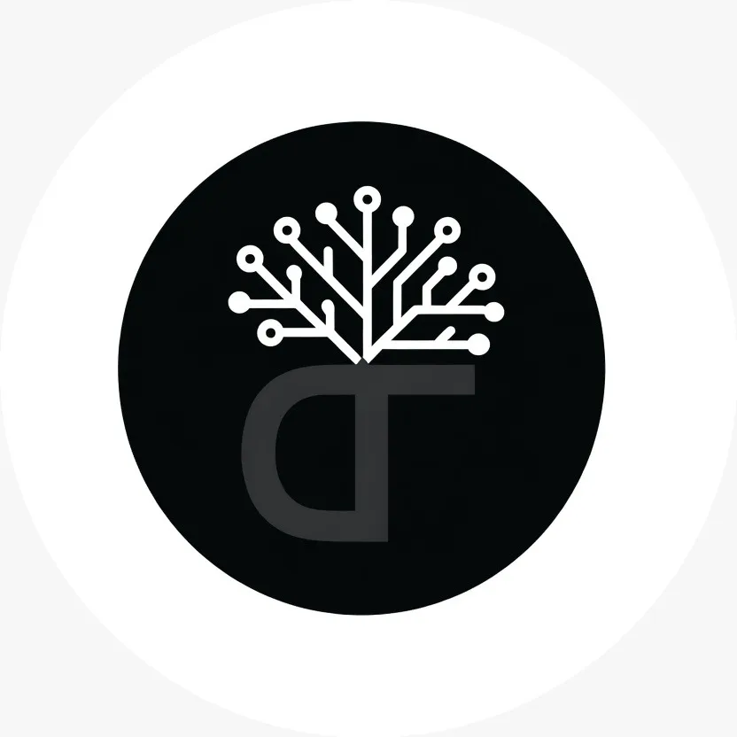
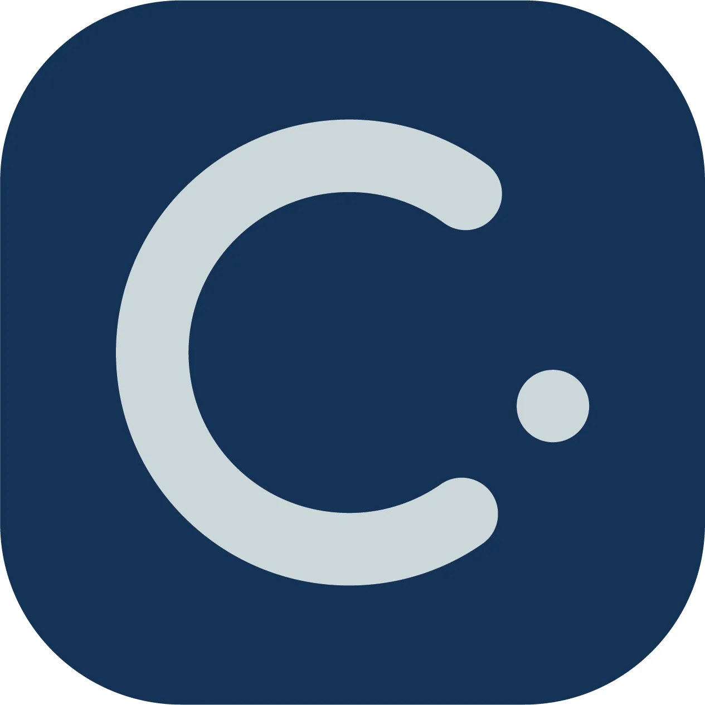

## Concepção

Olá a toda a comunidade de tecnologia! Me chamo Fabio Marinho e sou o fundador da Connections Hub. Dou as boas-vindas a todos vocês, amantes de tecnologia, entusiastas, interessados ou curiosos. São todos bem-vindos. Eu imaginei a Connections Hub como um ponto central de clientes, parceiros e desenvolvedores, onde todos nós pudéssemos falar sobre tecnologia. É esse lugar que aqui vou chamar de Hub. Sinta-se à vontade para comentar e opinar. Lembrando que aqui tudo que for escrito é baseado na minha opinião e na minha experiência como desenvolvedor.

## Afinal, o que é a Connections Hub?

Ela nasceu com outro nome, "Connections Tree", e com esta logo:

E a ideia não fugiu muito do escopo: uma empresa que concentrasse desenvolvedores e clientes, garantindo um ótimo atendimento, um lugar onde o cliente pode se sentir à vontade, um lugar de conexões, e conexões que levam a outras conexões e assim vai criando raízes, galhos e confiança.

## Connections Hub, a nova ideia

Com um rebranding feito através de uma parceria, chegamos ao consenso de que a Connections é mais que uma simples árvore, é uma semente e gera conexão, forma raízes do mesmo jeito, mas começa como uma semente, e daí vai se expandindo.

E esse foi o resultado: uma logo minimalista de que eu particularmente gostei muito. Aproveita para visitar o site da [Clozi Comunicação](https://www.clozicomunica.com/) e o Instagram deles, [@clozicomunica](https://www.instagram.com/clozicomunica/). Eles fizeram um trabalho massa com a minha marca.

## Objetivo do Blog

Minha ideia principal é compartilhar projetos, experiências e novidades, e tornar isso aqui um repositório de tudo que é relacionado a tecnologia.

Vou contar, por exemplo, como criei dois grandes sistemas do tipo ERP e como mantenho cada um deles, administrando, atualizando, e os erros também (ninguém vive acertando sempre).

## Até o próximo post

Vejo vocês em breve com novas atualizações, histórias e projetos. Espero vocês para comentários, opiniões e críticas.

> Software nunca tá pronto na versão 1.0. É sempre um trabalho em andamento. Se você acha que terminou a última linha de código e nunca mais vai mexer, provavelmente é um software que ninguém usa.
>
> — Fabio Akita

Isso define minha filosofia de projetos. Sou fã do [Fabio Akita](https://akitaonrails.com/) e, sim, esse blog é 100% inspirado nele, então queria deixar meus sinceros agradecimentos ao Akita pelas aulas, vídeos e tudo que ele deixou para nos ensinar.

Fiquem à vontade para conhecer o [meu site](https://www.connectionshub.com.br), com projetos, curiosidades e contato.

Abraços.
