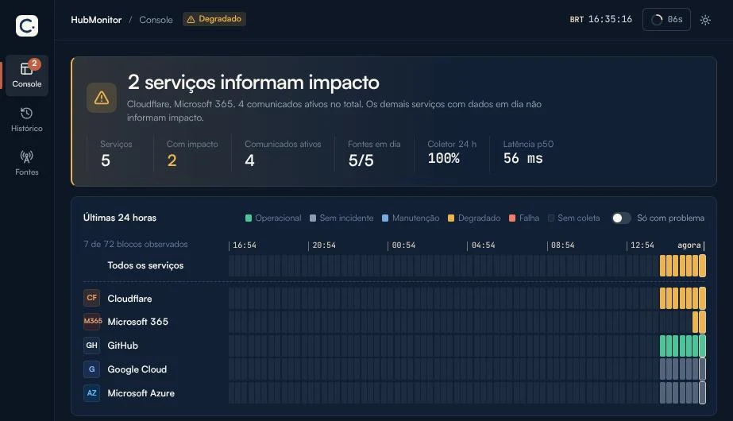

## O que é

Quando um serviço grande cai, a primeira pergunta é sempre a mesma: é aqui ou é lá? O site está fora ou é o provedor? Para responder isso eu tinha que abrir a página de status de cada fornecedor, uma por uma.

O **HubMonitor** junta tudo num lugar só. Ele lê o status oficial de **Cloudflare, Google Cloud, Microsoft Azure, Microsoft 365 e GitHub** a cada dois minutos e mostra num painel único o que está funcionando, o que está com problema e desde quando.

Está no ar em [monitor.connectionshub.com.br](https://monitor.connectionshub.com.br), e a home do site agora tem uma prévia ao vivo dele.

## O que aparece no painel

- **O estado geral**, numa frase: "nenhum impacto informado" ou quantos serviços estão com problema.
- **As últimas 24 horas** de cada serviço, em blocos de 20 minutos. Dá para ver em que hora um problema começou.
- **Os comunicados ativos** de cada fornecedor, com a linha do tempo das atualizações e o link para a fonte oficial.
- **Um log de eventos**: cada leitura, cada mudança de estado e cada aviso novo.
- **A saúde do próprio coletor**: quantas leituras deram certo e quanto tempo cada fonte levou para responder.

## A regra principal: não inventar

A ideia lembra o Downdetector, mas a base é outra. Em vez de relatos de usuários, o HubMonitor usa só o que os próprios fornecedores publicam. E ele não afirma nada que a fonte não disse:

- Algumas fontes, como Google Cloud, Azure e Microsoft 365, só publicam incidentes. Quando não há nenhum, o painel mostra **"Sem incidente"**, e não "Operacional". Não ter aviso não prova que está tudo funcionando.
- Se uma leitura falha, o último dado fica marcado como **desatualizado**. Ele nunca aparece como se fosse atual.
- Um incidente que some do feed não é dado como resolvido. Só conta como resolvido quando a fonte diz isso.
- Período sem leitura fica em branco no gráfico, nunca verde.
- Não existe "uptime de 99,9%" de terceiros calculado a partir de feed. Seria um número inventado.

Status oficial também não é a experiência de todo usuário. Cada serviço mostra a fonte, o que ela cobre e a hora da última leitura, para quem estiver olhando saber o peso de cada informação.

## Por baixo

- *Frontend* em **React** com Vite.
- API e coletor em **NestJS** (TypeScript), com **PostgreSQL**.
- Tudo num container Docker, no ar no Render, com *deploy* automático a cada *push*.
- A prévia na home do site é lida pelo servidor a cada dois minutos. Se o monitor estiver fora, a seção simplesmente não aparece.

O Microsoft 365 vem da página pública de status da Microsoft. Ela mostra incidentes de amplo impacto, não a saúde de um tenant específico; para isso seria preciso a integração autenticada com a Microsoft.

## Próximos passos

O HubMonitor está na primeira versão e vai continuar mudando:

- mais serviços no catálogo;
- alertas quando algum serviço mudar de estado;
- o monitoramento dos sistemas da própria Connections Hub.

Se tiver um serviço que você gostaria de ver lá, comenta aqui embaixo.
